# V3 四端高保真产品原型图册

这些图像来自可运行Demo的浏览器截图。深蓝与青绿数据舱、浅色运营后台、草原绿与米白手机端共用产品视觉语言。截图取自不同演示时刻，因此实时数据会有变化。手机按iPhone 15的393×852逻辑尺寸验证；支付与会员的两张早期联调截图有局部裁切，其余移动图为393×852。

## 领导数据舱

### 全省总览 1920×1080

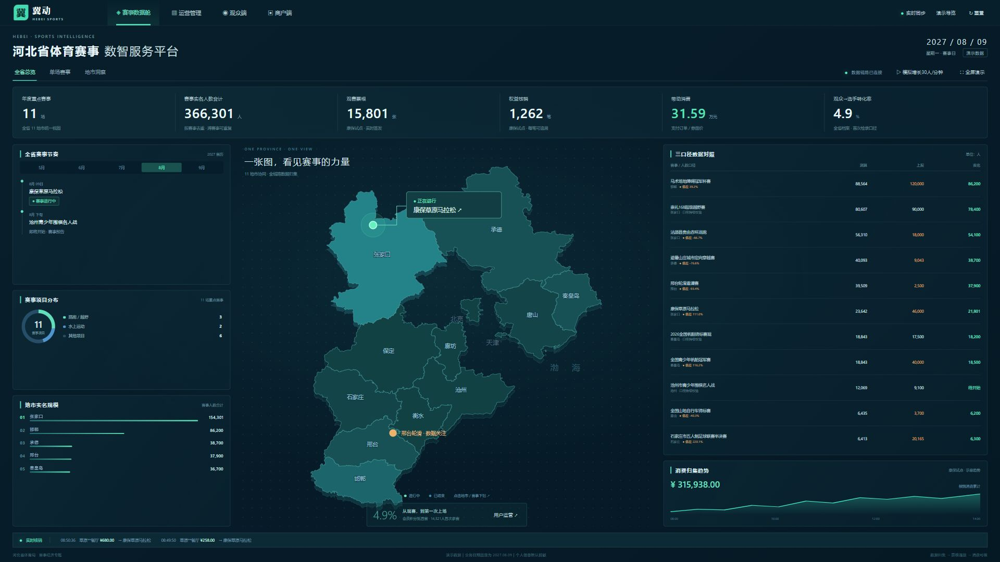

### 全省总览 4K

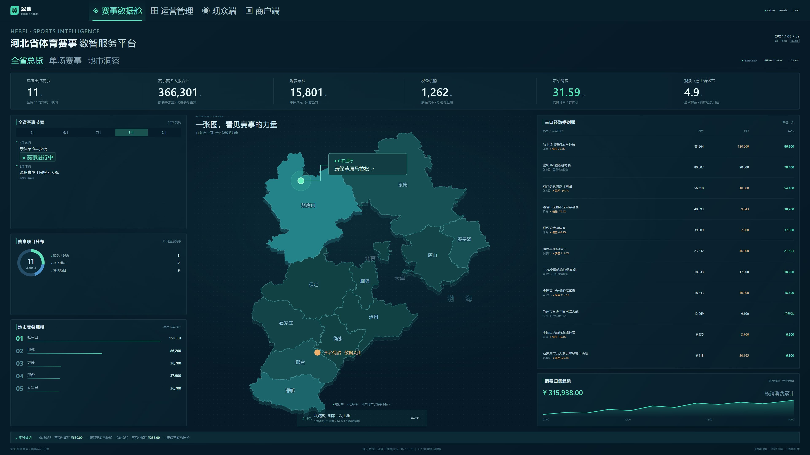

### 康保赛事日

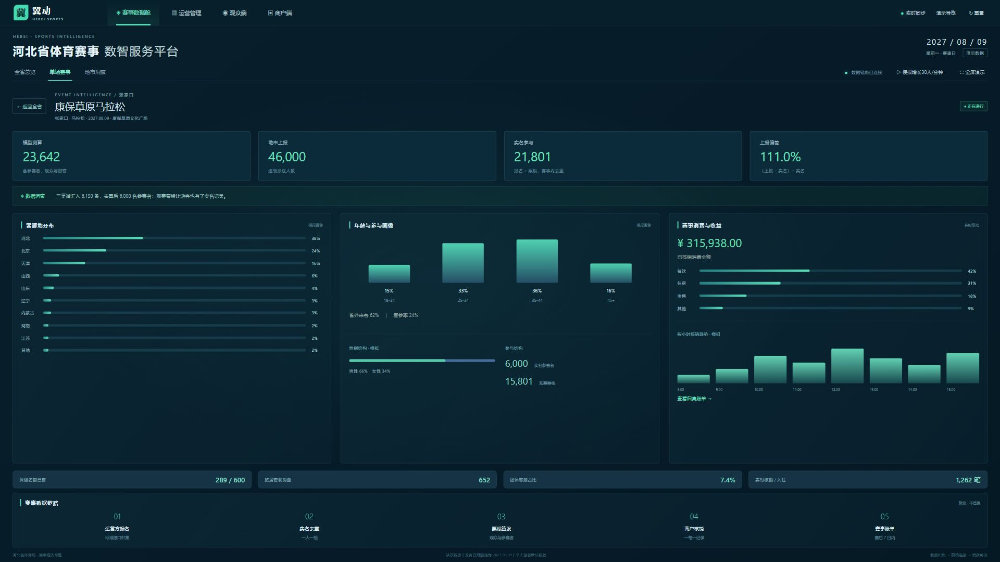

### 邢台轮滑偏差分析

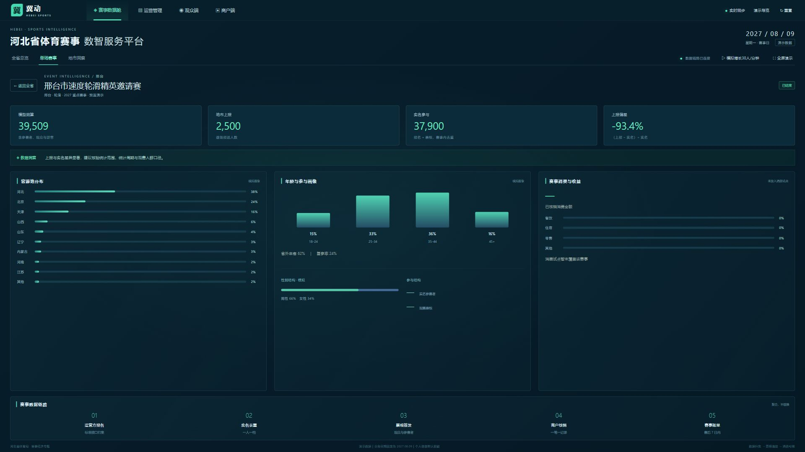

## 用户运营后台

新增转化率、五级转化漏斗、段位结构、会员结构与运营任务；旅居管理的最新订单数口径以运行页面为准，不混用订单和人数。

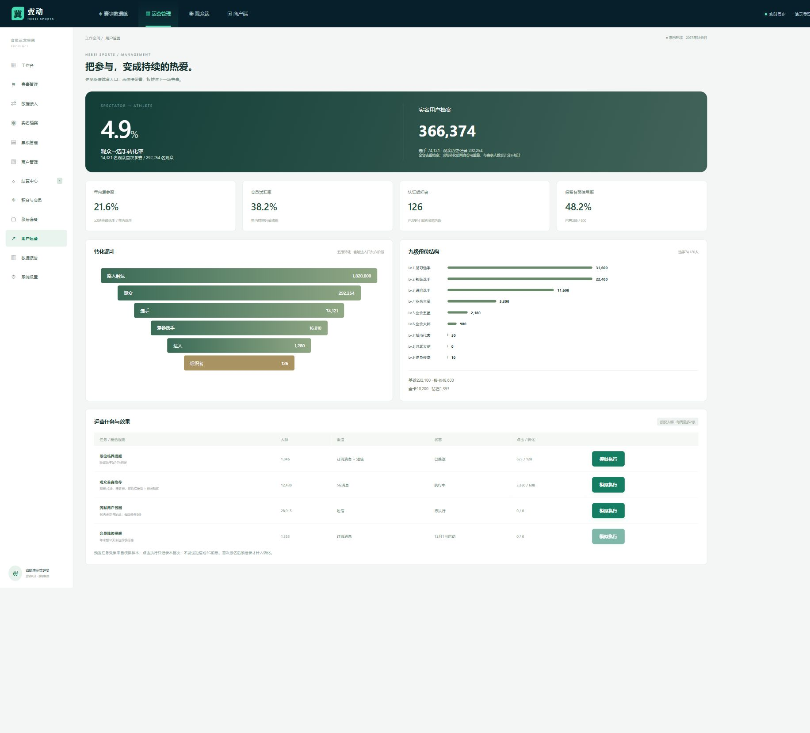

## 观众端与选手端

| 支付即核销 | 会员积分入账 |
| --- | --- |
| 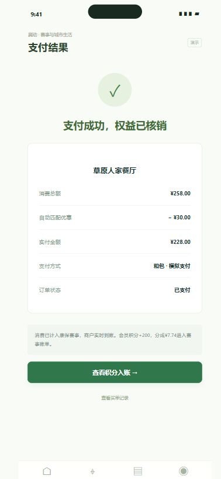 | 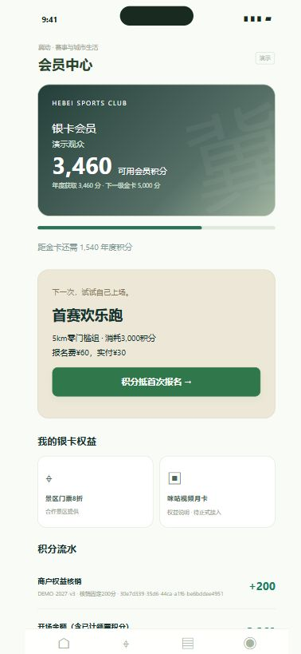 |

| 首次报名抵扣 | Lv.4段位与指导员资格 |
| --- | --- |
| 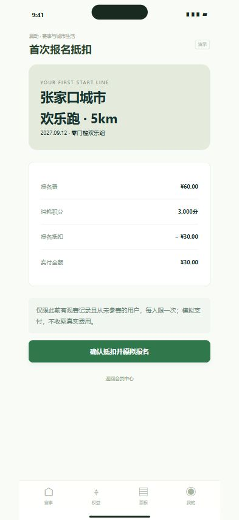 | 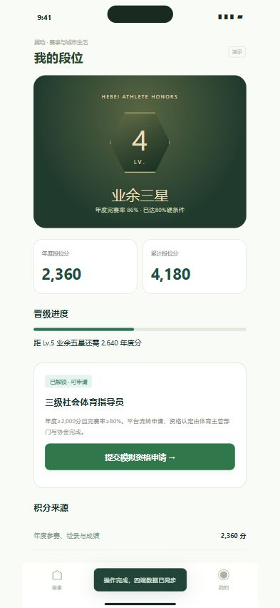 |

| 赛事旅居列表 | 套餐报名与住宿凭证 |
| --- | --- |
| 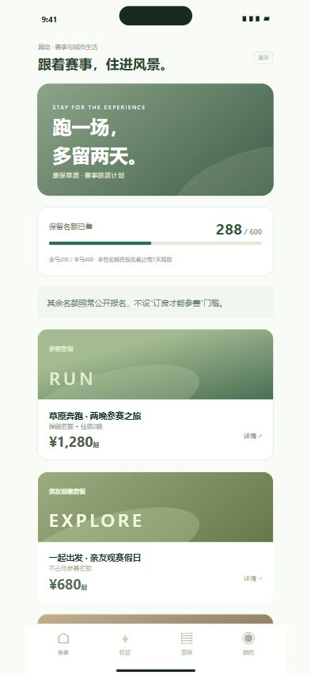 | 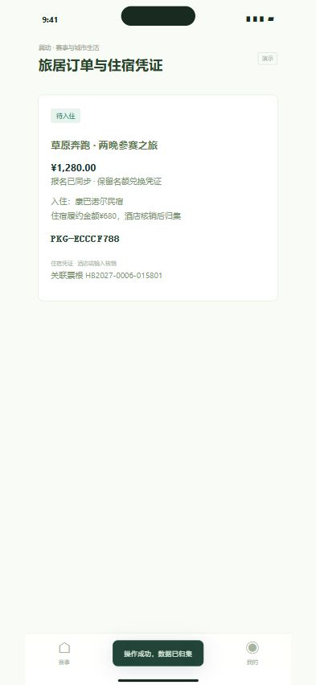 |

## 商户端

买单成功自动到账，券码取不可编辑的券面价，酒店凭套餐凭证核销入住。

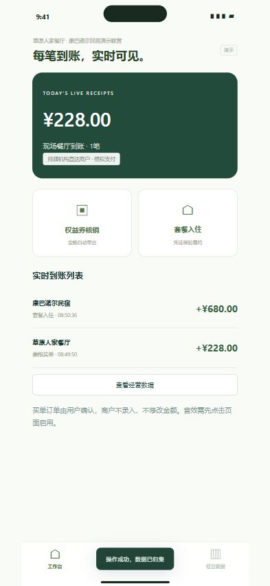

## 运行与讲解

[25分钟演示手册](DEMO.md) · [启动与各端入口](../README.md) · [自测记录](VERIFICATION.md)

早期版本截图保留在screenshots根目录，仅作版本档案；V3原型在screenshots/v3。支付、资质、实名与第三方接口均为模拟，尚未在实体iPhone及省局屏幕硬件上验收。
