# 四端高保真产品原型图册

这些原型图直接来自可运行 Demo，截图与实际交互页面共用同一份实现。手机端验证视口为 iPhone 15 的 393×852 CSS 像素；截图工具的像素取整可能产生 1 像素高度差。

## 领导数据舱

### 全省总览 1920×1080

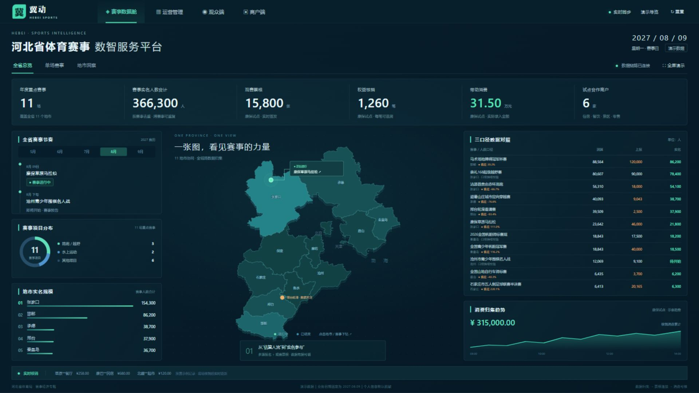

### 4K 全省总览 3840×2160

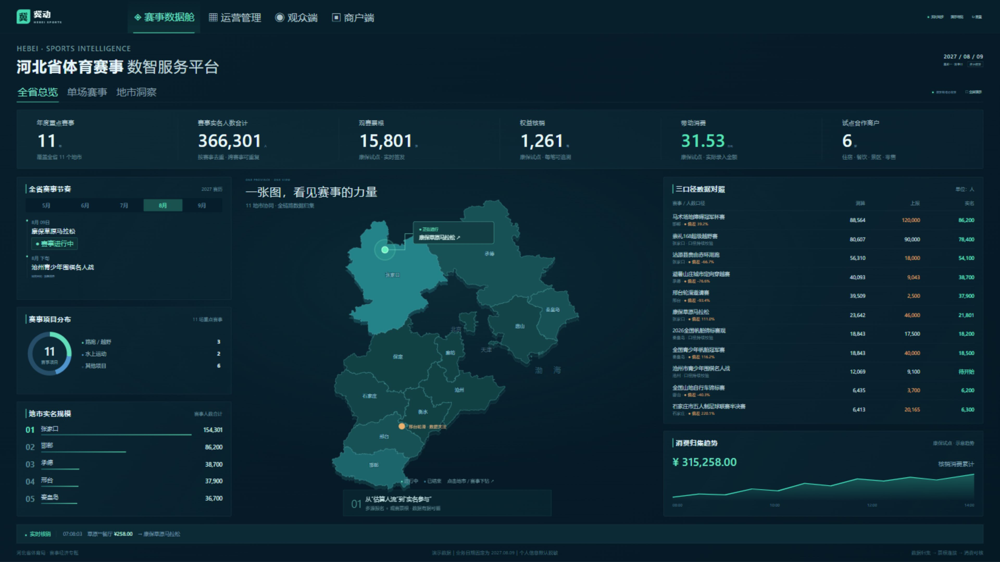

### 单场赛事 邢台轮滑

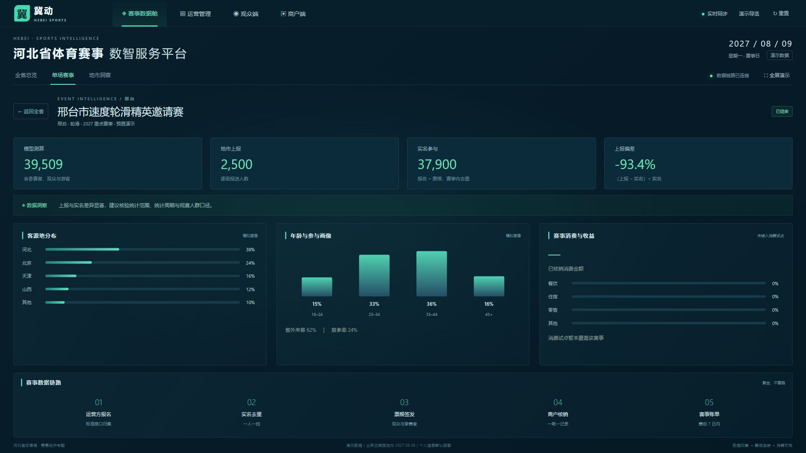

### 单场赛事 康保草原马拉松

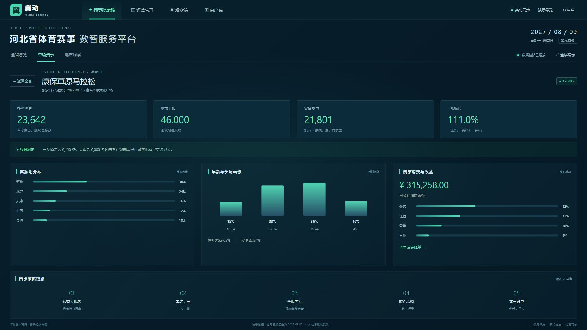

### 地市洞察

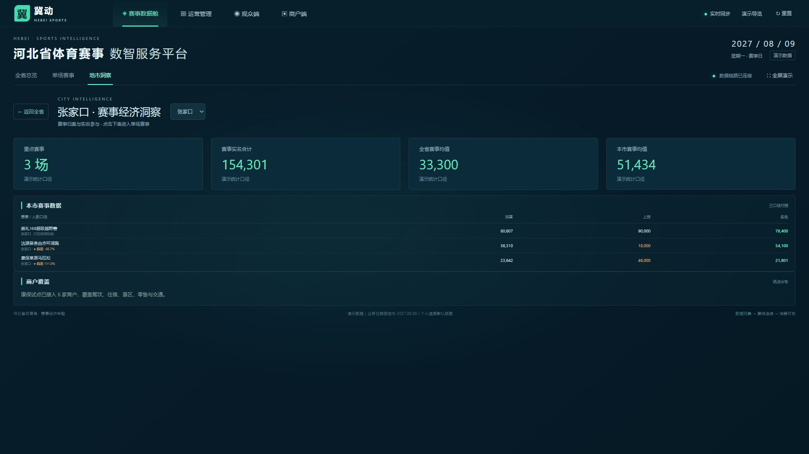

## 运营管理

### 工作台

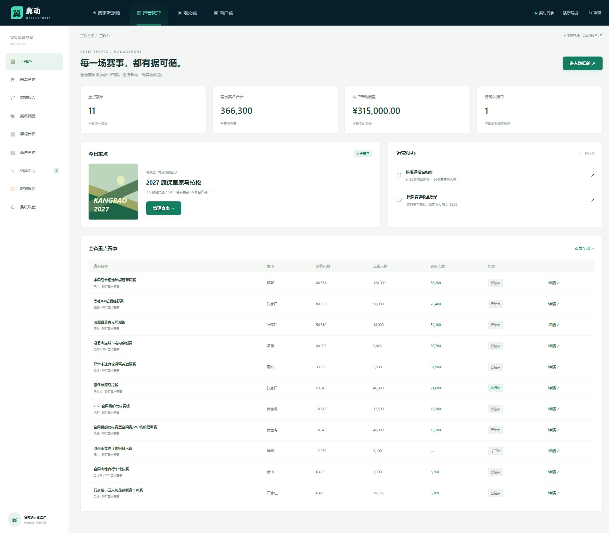

### 数据接入与跨源去重

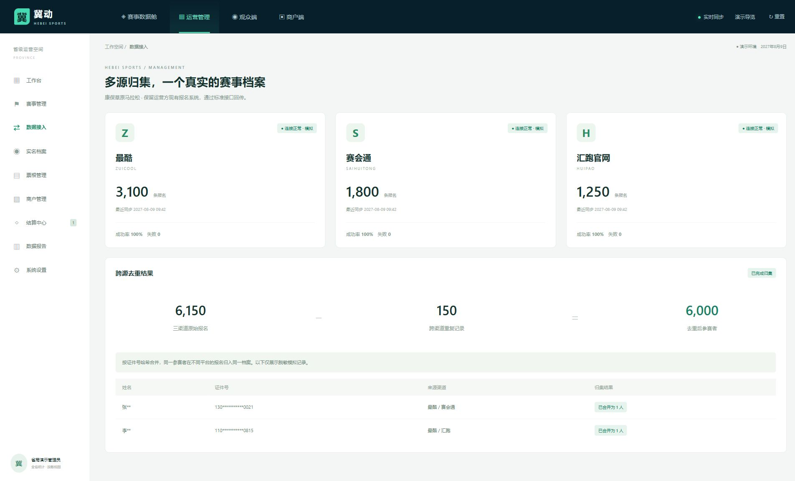

### 赛事详情

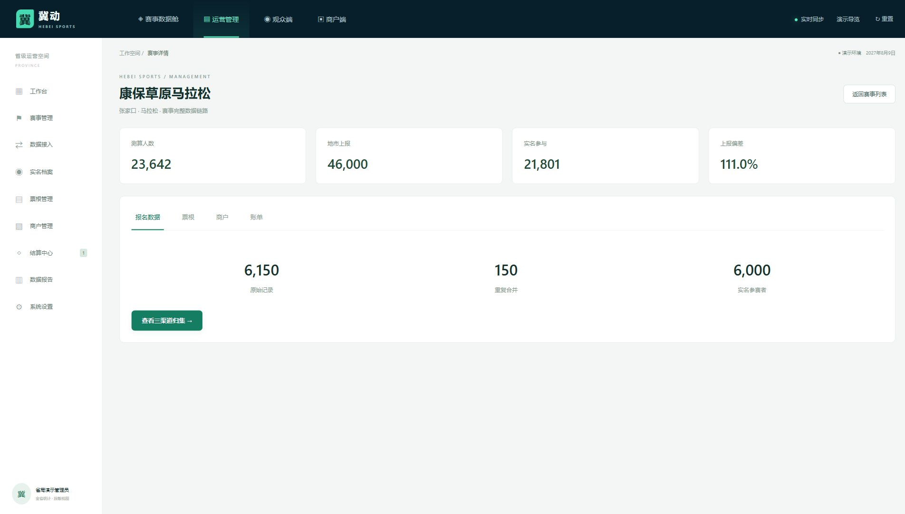

### 收益账单与确认

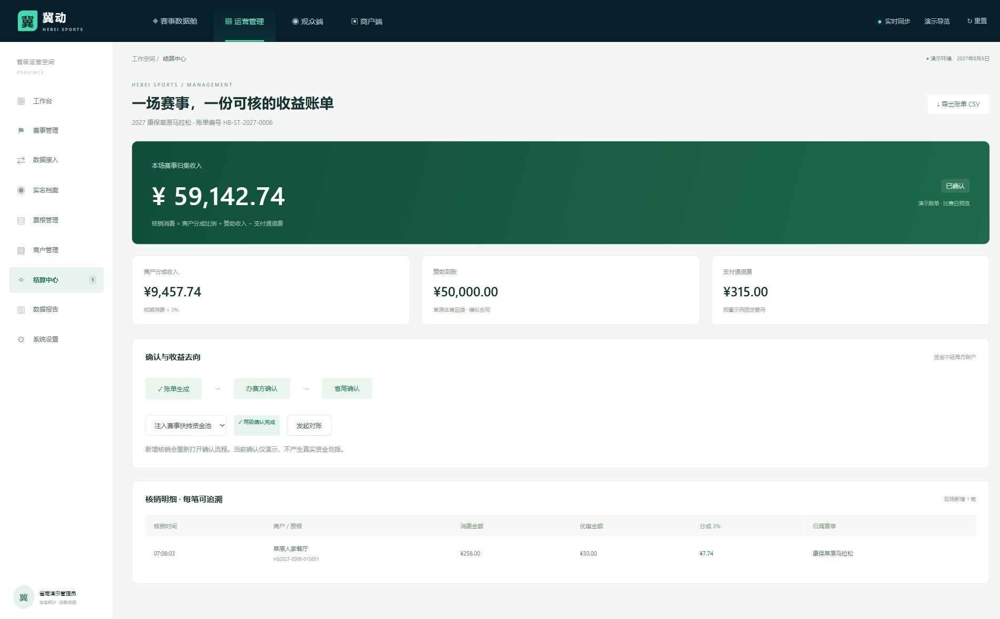

## 观众端 iPhone 15

| 赛事首页 | 模拟实名领取 | 电子票根 |
| --- | --- | --- |
| 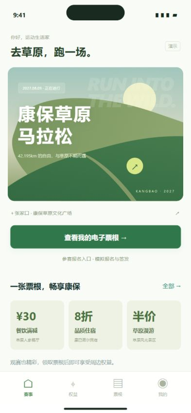 | 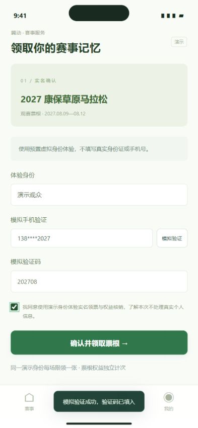 | 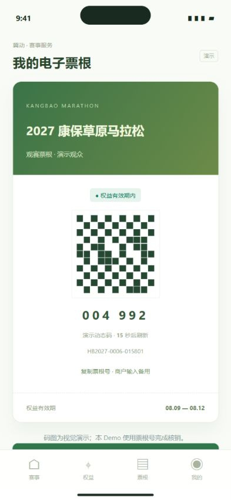 |

| 权益地图 | 权益使用记录 |
| --- | --- |
| 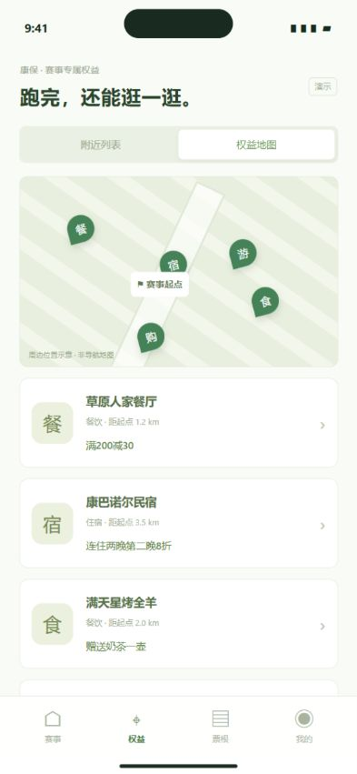 | 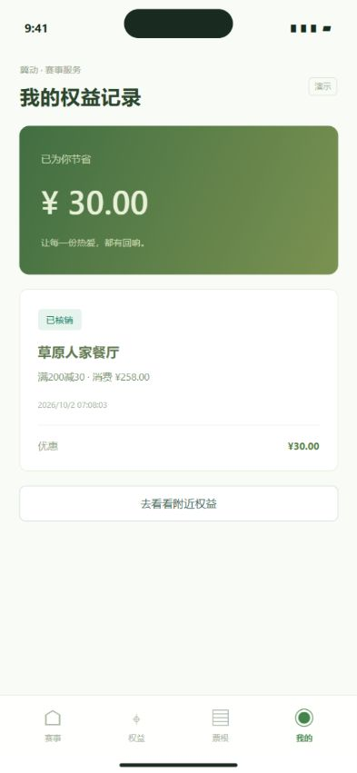 |

## 商户端 iPhone 15

| 核销确认 | 成功回执 |
| --- | --- |
| 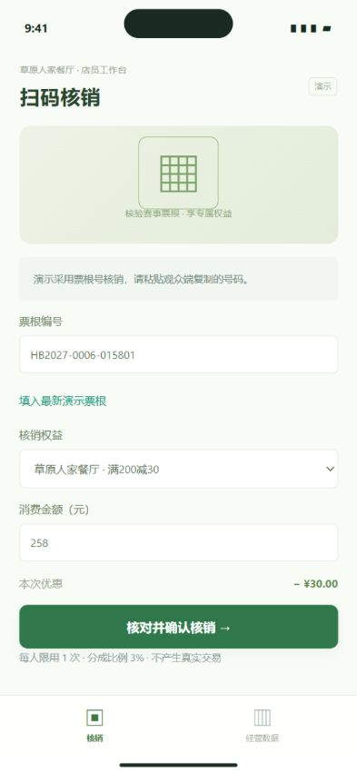 | 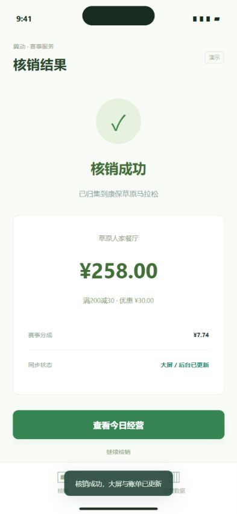 |

运行方式、局域网手机访问和完整20分钟脚本见 [演示手册](DEMO.md) 与 [README](../README.md)。
